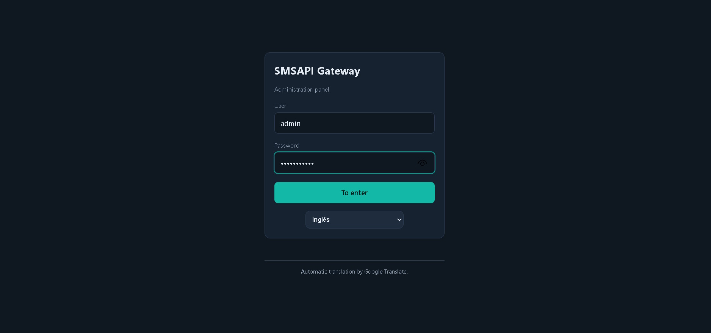
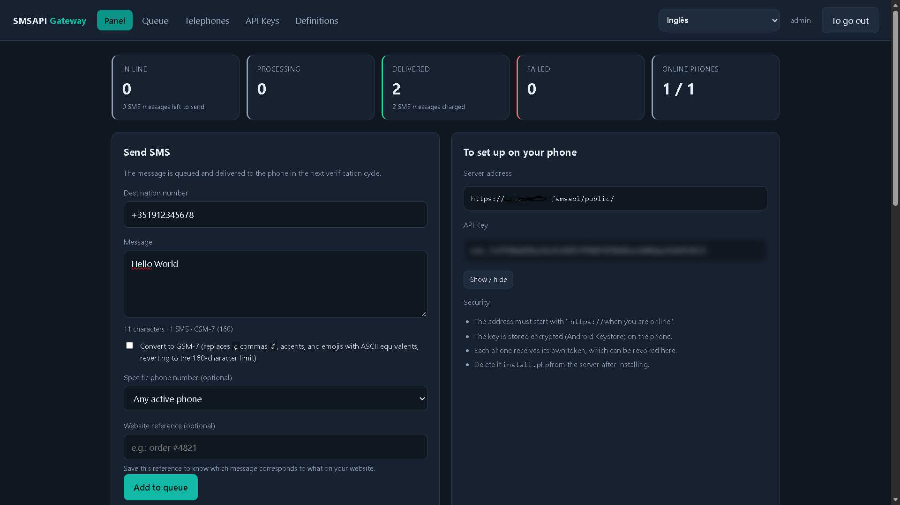
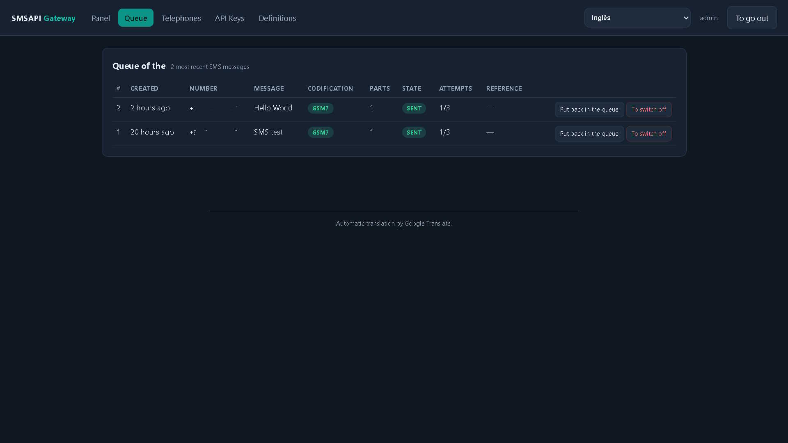
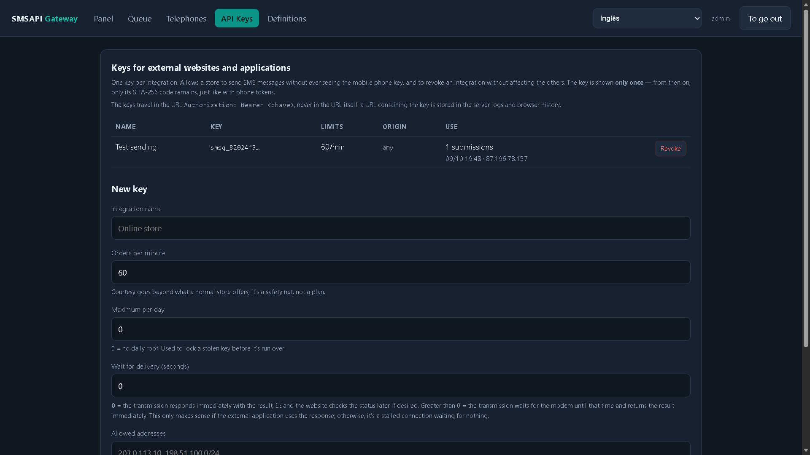
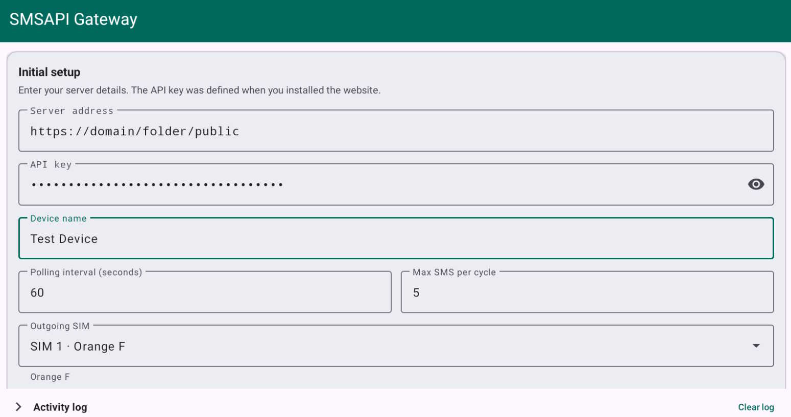
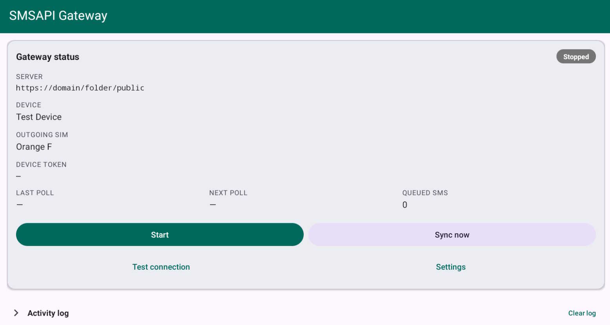
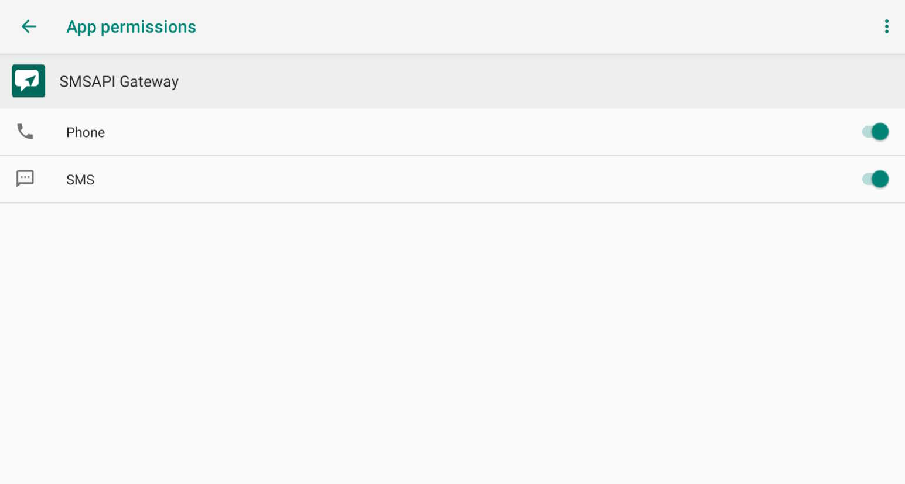

# SMSAPI Gateway

SMSAPI Gateway is a self-hosted system that lets a website send SMS messages through an Android phone.

The website submits messages to a PHP API queue. The Android app periodically polls the server, sends the queued messages through the phone’s SIM card, and reports delivery status. An admin panel manages the queue, devices, API keys, users, and delivery history.

Presentation Video: https://youtu.be/B0JNSwwqKr8?si=B2Vu5cpaORhyJQ8n

## Requirements

### Web and API server

- PHP 8.1 or later; tested with PHP 8.2.29.
- PHP extensions:
  - `pdo`
  - `mbstring`
  - `pdo_sqlite` for SQLite, or `pdo_mysql` for MySQL/MariaDB.
- HTTPS in production.
- Apache with `AllowOverride All`, or equivalent Nginx rules blocking `storage/`, `src/`, and `cron/`.
- Writable `api/` and `api/storage/` directories.
- Optional, but recommended: run `api/cron/maintain.php` every 15 minutes.

### Android app

- Android 7.0/API level 24 or later.
- Built against API level 36.
- A phone with an active SIM card and an SMS plan.
- Install `../dist/smsapi-gateway-1.0.0.apk`.
- Grant the permissions requested during setup, especially:
  - `SEND_SMS`
  - `INTERNET`
  - `ACCESS_NETWORK_STATE`
  - `READ_PHONE_STATE`
  - `POST_NOTIFICATIONS`
  - `FOREGROUND_SERVICE` and `FOREGROUND_SERVICE_SPECIAL_USE`
  - `RECEIVE_BOOT_COMPLETED`
  - `WAKE_LOCK`
  - `REQUEST_IGNORE_BATTERY_OPTIMIZATIONS`

## Screenshots

### Web admin panel

### Android app

